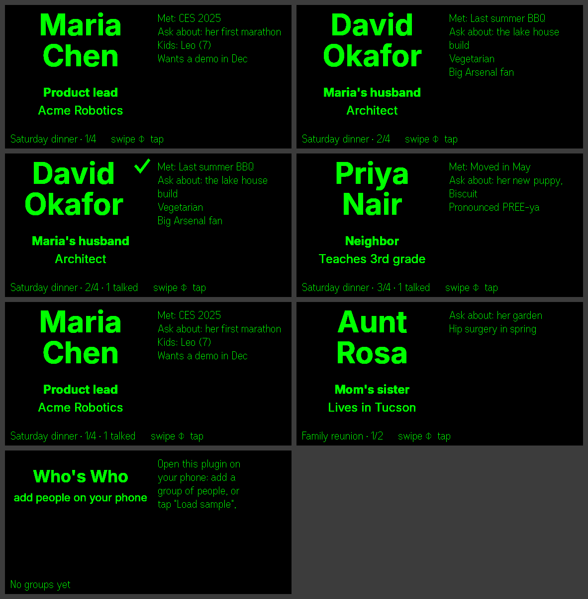

# Who's Who for Even G2

Never blank on a name again. Before a dinner, meeting or reunion, put the people you'll see into a group on your phone. On the glasses you get one card per person: name, role, where you met, what to ask about, and a few notes. Swipe through them in seating order and tap to mark who you've talked to.



- **Groups** for each occasion: "Saturday dinner", "Acme team", "Family reunion"
- **Person cards** with a big name, role and company, plus *Met*, *Ask about* and notes (pronunciation, kids' names, dietary needs)
- **Swipe** (touchpad or R1 ring) moves through people in the order you set: seating order, agenda order, or arrival order
- **Tap** marks someone ✓ talked; the status line keeps count
- **Import**: paste names one per line, a CSV with a header row, or a LinkedIn connections export
- **Sample groups** to see it working straight away
- **Private by design**: no account, no server, no internet access. Everything stays in the Even app on your phone.

## Code

| File | Role |
|---|---|
| `src/people.ts` | Groups/people model, CSV & LinkedIn import, name line-breaking, sample data (pure, unit-tested) |
| `src/render.ts` | Canvas → PNG for the big name and role/company tiles (on/off pixels only) |
| `src/hud.ts` | 576×288 layout: 2 image + 2 text containers |
| `src/phone-ui.ts`, `index.html` | Phone editor: groups, people, reorder, import, mirror controls |
| `src/storage.ts` | Persists to the Even app's per-plugin storage |

## Develop

```bash
npm install
npm run dev                                   # vite :5173
npx evenhub-simulator "http://localhost:5173/?sample"   # dev-only: start with sample groups
npm test                                      # 10 unit tests
npm run build && npx evenhub pack app.json dist -o whos-who.ehpk --sdk-ver 0.0.10
```

The shipped bundle contains no URLs and the manifest requests no permissions.

## License

MIT
